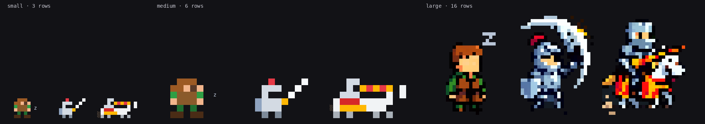

# medieval-bar

A Claude Code mod that adds a medieval RPG-style stat bar above your prompt, with **Sir Pip**, an animated pixel-art mascot who reacts to what Claude is doing.


## What the bar shows

| Stat | Meaning |
| --- | --- |
| ♥ **Health** | How much of the context window is left. It drains as the conversation grows. At 20% or less you get a "gravely wounded" warning. |
| ⚔ **Stamina** | How much of your 5-hour usage limit is left. |
| ☾ **Energy** | How much of your 7-day usage limit is left. |
| ⛁ **Groschen** | What the session would cost at API prices, 1 groschen per US cent. On a subscription you are not billed this; it shows how heavy the session has been. |

Stamina and Energy only appear when your account reports usage limits (Pro, Max, Team and Enterprise plans).

## Sir Pip

Sir Pip has three looks, each animated:

| When | Look | He says |
| --- | --- | --- |
| Claude is idle, waiting for you | A sleeping peasant, breathing, with "z"s floating up | "Zzz... give me a quest." |
| Claude is thinking or writing | A knight swinging his sword, ending in a spark | "To battle!" |
| Claude is running a tool | A knight on horseback with a lance, galloping and kicking up dust | "Charge!" |

When Health runs low, his lines change to remind you to rest.

### Sizes



| Size | Height | Style |
| --- | --- | --- |
| `small` (default) | 3 rows | Hand-drawn, about the size of Claude's old mascot |
| `medium` | 6 rows | The small figures at double size |
| `large` | 16 rows | Detailed figures made from the reference art |

If the terminal window is too short for the size you picked, Sir Pip drops to the biggest size that fits.

## Commands

| Command | What it does |
| --- | --- |
| `/hud` | Hide or show the bar |
| `/hud small` · `/hud medium` · `/hud large` | Change Sir Pip's size |
| `/rest` | "Rest at the inn": compacts the conversation, which refills Health |

The size can also be changed under **Mascot size** in `/config`.

## Installing

1. Put the `medieval-bar` folder somewhere permanent, for example:
   - Windows: `C:\Users\<you>\claude-mods\medieval-bar`
   - macOS / Linux: `~/claude-mods/medieval-bar`
2. Start Claude Code with the mod loaded:

   ```
   claude --plugin-dir C:\Users\<you>\claude-mods\medieval-bar
   ```

3. Send a message. The bar appears above the prompt once Claude replies.

### Loading it every time

To skip the flag, add the folder to the `env` block of your user settings: `%USERPROFILE%\.claude\settings.json` on Windows, `~/.claude/settings.json` on macOS and Linux.

```json
{
  "env": {
    "CLAUDE_CODE_PLUGIN_DIRS": "C:\Users\<you>\claude-mods\medieval-bar"
  }
}
```

### Updating

Replace the folder's contents with the new version and restart Claude Code. If you are updating from an early version, delete any files the new version does not include.

## Requirements

- Claude Code with function-hook mods (built against 2.1.316). The mod API is in early access and may change between releases.
- **A terminal with 24-bit colour** for the pixel art: Windows Terminal, iTerm2, WezTerm, Kitty, VS Code's terminal and most modern Linux terminals work. The old Windows `cmd.exe` console may show the wrong colours.
- The pixel art only draws in the terminal. On the desktop app Sir Pip falls back to a small text face (`[^_^]`). The VS Code extension and mobile don't show the bar at all.

## Troubleshooting

| Symptom | Likely cause |
| --- | --- |
| `Unknown command: /hud` | The mod isn't loaded. Check the `--plugin-dir` path or `CLAUDE_CODE_PLUGIN_DIRS`, then restart Claude Code. |
| No bar after starting | The bar fills in after Claude's first reply, so send a message. If it's still missing, it may be hidden: type `/hud`. |
| Sir Pip looks like coloured noise | Your terminal doesn't support 24-bit colour. Try Windows Terminal or another modern terminal. |
| Sir Pip is smaller than the size you chose | The window is too short for that size. Make the terminal taller. |
| `/stats` opens a usage screen | That's Claude Code's built-in `/stats`. The bar's toggle is `/hud`. |

For more detail, start Claude Code with `--debug`: the debug log names any hook of this mod that failed, and why.

## Files

```
medieval-bar/
├── .claude-plugin/plugin.json   manifest and the "Mascot size" option
├── hooks/
│   ├── hooks.json               points Claude Code at register.tsx
│   ├── register.tsx             the bar, the commands and the animation timer
│   ├── frames.ts                small and medium figures and their frames
│   ├── frames-large.ts          large figures and their frames
│   ├── figures.ts               large figures' pixel data
│   └── sprite.ts                draws pixels in the terminal with half-block characters
├── types/index.d.ts             the mod's saved-state contract
├── tests/bar.test.tsx           tests
└── docs/                        the preview images in this README
```

## Developing

```
claude plugin validate <path-to-medieval-bar>   # checks the manifest and hooks module
claude plugin test <path-to-medieval-bar>       # runs tests/bar.test.tsx
```

While developing, start Claude Code with `--plugin-dir` pointing at the folder. In an interactive session, the folder is watched and the mod reloads when you save a file.

## Credits

Sir Pip and the bar were made with Claude. The large figures are based on reference art supplied by the mod's author, and the small and medium figures are hand-drawn after it. This mod is not affiliated with or endorsed by any game or studio.
